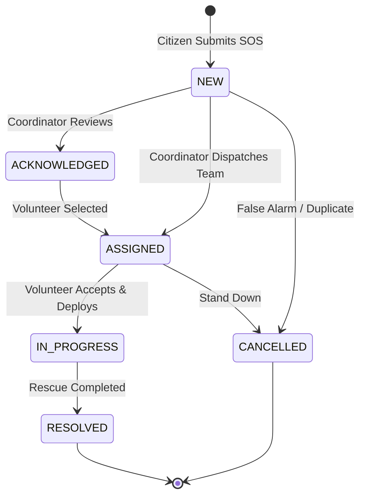
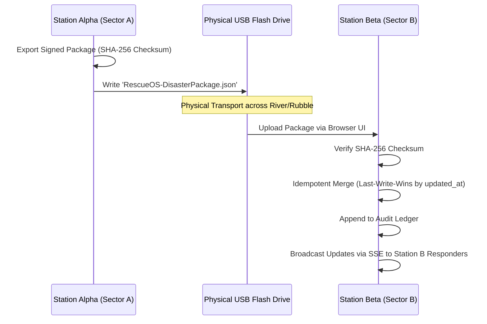

# RescueOS System Architecture

**“Boot. Connect. Rescue.”**

RescueOS is a portable, offline disaster communication and coordination operating system designed to run on standard consumer laptops and phones when all external internet, cellular towers, and grid power are offline.

---

## 1. High-Level Architecture

```mermaid
graph TD
    subgraph Host Laptop / Field Station [RescueOS Host Station]
        direction TB
        AP[Built-in Wi-Fi AP / Hotspot: 'RESCUEOS-EMERGENCY']
        HTTP[Pure Node.js HTTP & SSE Engine (Port 8080)]
        SQLITE[(Local SQLite Database Engine - node:sqlite)]
        SIM[Disaster Simulation Engine]
        SYNC[Multi-Station & USB Package Engine]
        LORA[Pluggable LoRa Transport Interface]
    end

    subgraph Client Tier [Connected Emergency Clients]
        direction TB
        CITIZEN[Citizen Mobile UI: SOS, Status, QR ID]
        VOLUNTEER[Volunteer Mobile UI: Tasks, Field Notes, Rescues]
        MEDICAL[Medical Officer UI: Triage, Clinical Intake, Supplies]
        COMMAND[Desktop Command Center: Dispatch, Broadcasts, Telemetry]
    end

    AP -->|LAN HTTP / SSE| CITIZEN
    AP -->|LAN HTTP / SSE| VOLUNTEER
    AP -->|LAN HTTP / SSE| MEDICAL
    AP -->|Localhost / LAN| COMMAND

    HTTP <--> SQLITE
    HTTP <--> SIM
    HTTP <--> SYNC
    HTTP <--> LORA
```

---

## 2. Core Architectural Pillars

### 2.1 Zero-Cost & Zero-Dependency Execution
- **Runtime:** Built entirely on Node.js standard libraries (`http`, `node:sqlite`, `crypto`, `os`, `fs`, `path`).
- **Zero NPM Runtime Dependencies:** No risk of broken native module compilation, missing cloud packages, or offline `npm install` failures.
- **₹0 / $0 Cost:** Operates on standard existing laptops and smartphones without purchasing specialized sensors, external routers, or cloud subscriptions.

### 2.2 Offline-First Design
- **Bundled Assets:** The QR code generator is bundled locally inside `frontend/`.
- **Zero Remote CDN Requests:** No references to unpkg, Google Fonts, or cdnjs.
- **Hazard reports:** Incidents and roadblocks are stored and shown as operational records; no map view is included.

---

## 3. Emergency SOS Lifecycle State Machine



1. **NEW:** Distress call received and logged with high-contrast alert. Real-time push broadcast to all connected command monitors.
2. **ASSIGNED:** Linked to volunteer rescue team; task queue item generated.
3. **IN_PROGRESS:** Volunteer confirms arrival on scene or boat deployment. Field observations appended.
4. **RESOLVED:** Evacuees safely delivered to shelter or medical triage; resolution notes committed to immutable audit trail.

---

## 4. Multi-Station & USB Sync Architecture (Step 26 & 27)

When disaster areas span multiple isolated sectors with separated Wi-Fi coverage:



---

## 5. Pluggable LoRa Transport Interface

In accordance with strict project rules, physical LoRa hardware is not simulated as present if disconnected. Instead, RescueOS provides a pluggable transport abstraction in `backend/lora_adapter.js`.

### 5.1 Binary Packet Frame Format (`RescueOS-LoRa-Frame-v1`)

```
+------------+-----------+-------------+---------------------+-------------------+------------+
| Magic (2B) | Ver (1B)  | MsgType(1B) | Sequence / Time(4B) | Payload (Variable)| CRC16 (2B) |
|   0x52 0x01|   0x01    | 0x01 (SOS)  |    0x66F58A02       | Compressed JSON   | 0xA4F2     |
+------------+-----------+-------------+---------------------+-------------------+------------+
```

When compatible UART transceiver hardware (e.g., SX1262 USB adapter) is connected, the transport module automatically activates long-range, low-bandwidth text transmission.
