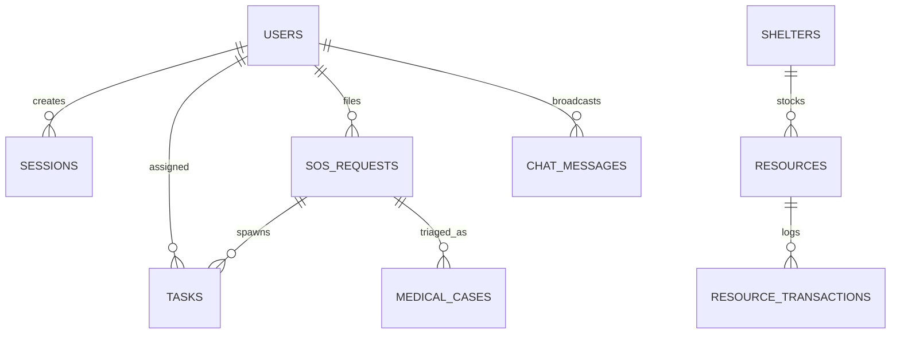

# RescueOS Database Architecture

RescueOS relies on an embedded, zero-dependency SQLite database powered by Node.js built-in `node:sqlite` (`DatabaseSync`).

---

## 1. Storage Location & Engine

- **File Path:** `backend/rescueos.sqlite`
- **Legacy Mirror:** `backend/rescueos-data.json` (auto-synchronized on mutations for backwards compatibility with external scripts)
- **Engine:** Built-in SQLite 3 with Foreign Key constraints enabled (`PRAGMA foreign_keys = ON;`).

---

## 2. Entity Relationship Diagram



---

## 3. Tables & Schema Definitions

### 3.1 `users`
Stores authenticated personnel across all operational tiers.
```sql
CREATE TABLE users (
  id INTEGER PRIMARY KEY AUTOINCREMENT,
  username TEXT UNIQUE NOT NULL COLLATE NOCASE,
  password_hash TEXT NOT NULL,
  salt TEXT NOT NULL,
  full_name TEXT NOT NULL,
  role TEXT NOT NULL CHECK(role IN ('CITIZEN', 'VOLUNTEER', 'MEDICAL', 'COORDINATOR', 'ADMIN')),
  phone TEXT DEFAULT '',
  badge_number TEXT DEFAULT '',
  created_at TEXT NOT NULL
);
```

### 3.2 `sessions`
Active session tokens with automatic TTL expiration.
```sql
CREATE TABLE sessions (
  token TEXT PRIMARY KEY,
  user_id INTEGER NOT NULL REFERENCES users(id) ON DELETE CASCADE,
  role TEXT NOT NULL,
  username TEXT NOT NULL,
  expires_at INTEGER NOT NULL,
  created_at TEXT NOT NULL
);
```

### 3.3 `sos_requests`
Primary emergency distress signals.
```sql
CREATE TABLE sos_requests (
  id INTEGER PRIMARY KEY AUTOINCREMENT,
  rescue_id TEXT UNIQUE NOT NULL,
  requester TEXT NOT NULL,
  user_id INTEGER REFERENCES users(id) ON DELETE SET NULL,
  emergency_type TEXT NOT NULL CHECK(emergency_type IN ('MEDICAL', 'FLOOD', 'FIRE', 'TRAPPED', 'MISSING_PERSON', 'FOOD_WATER', 'STRUCTURAL_DAMAGE', 'OTHER')),
  description TEXT NOT NULL,
  people_affected INTEGER NOT NULL DEFAULT 1,
  priority TEXT NOT NULL CHECK(priority IN ('CRITICAL', 'HIGH', 'MEDIUM', 'LOW')),
  location TEXT NOT NULL,
  lat REAL DEFAULT NULL,
  lng REAL DEFAULT NULL,
  status TEXT NOT NULL CHECK(status IN ('NEW', 'ACKNOWLEDGED', 'ASSIGNED', 'IN_PROGRESS', 'RESOLVED', 'CANCELLED')),
  assigned_volunteer TEXT DEFAULT NULL,
  assigned_volunteer_id INTEGER REFERENCES users(id) ON DELETE SET NULL,
  notes TEXT DEFAULT '',
  resolution TEXT DEFAULT '',
  triage_level TEXT DEFAULT 'NONE',
  is_simulation INTEGER NOT NULL DEFAULT 0,
  created_at TEXT NOT NULL,
  updated_at TEXT NOT NULL
);
```

### 3.4 `tasks`
Field assignments dispatched to volunteer teams.
```sql
CREATE TABLE tasks (
  id INTEGER PRIMARY KEY AUTOINCREMENT,
  sos_id INTEGER NOT NULL REFERENCES sos_requests(id) ON DELETE CASCADE,
  volunteer_id INTEGER REFERENCES users(id) ON DELETE SET NULL,
  volunteer_name TEXT NOT NULL,
  status TEXT NOT NULL CHECK(status IN ('ASSIGNED', 'ACCEPTED', 'EN_ROUTE', 'IN_PROGRESS', 'RESOLVED', 'ABORTED')),
  instructions TEXT DEFAULT '',
  field_notes TEXT DEFAULT '',
  created_at TEXT NOT NULL,
  updated_at TEXT NOT NULL
);
```

### 3.5 `shelters`
Evacuation centers and disaster shelters.
```sql
CREATE TABLE shelters (
  id INTEGER PRIMARY KEY AUTOINCREMENT,
  name TEXT NOT NULL,
  location TEXT NOT NULL,
  lat REAL DEFAULT NULL,
  lng REAL DEFAULT NULL,
  capacity INTEGER NOT NULL DEFAULT 100,
  occupancy INTEGER NOT NULL DEFAULT 0,
  contact TEXT DEFAULT '',
  medical_support INTEGER NOT NULL DEFAULT 1,
  accessibility INTEGER NOT NULL DEFAULT 1,
  status TEXT NOT NULL CHECK(status IN ('OPEN', 'FULL', 'CLOSED', 'EMERGENCY_ONLY')),
  water_liters INTEGER NOT NULL DEFAULT 0,
  food_rations INTEGER NOT NULL DEFAULT 0,
  medical_kits INTEGER NOT NULL DEFAULT 0,
  blankets INTEGER NOT NULL DEFAULT 0,
  is_simulation INTEGER NOT NULL DEFAULT 0,
  created_at TEXT NOT NULL,
  updated_at TEXT NOT NULL
);
```

### 3.6 `resources` & `resource_transactions`
Disaster logistics inventory and movement ledger.
```sql
CREATE TABLE resources (
  id INTEGER PRIMARY KEY AUTOINCREMENT,
  shelter_id INTEGER REFERENCES shelters(id) ON DELETE CASCADE,
  name TEXT NOT NULL,
  category TEXT NOT NULL CHECK(category IN ('Water', 'Food', 'Medicine', 'Blankets', 'Fuel', 'First Aid', 'Clothing', 'Other')),
  quantity REAL NOT NULL DEFAULT 0,
  unit TEXT NOT NULL,
  minimum_threshold REAL NOT NULL DEFAULT 10,
  is_simulation INTEGER NOT NULL DEFAULT 0,
  last_updated TEXT NOT NULL
);

CREATE TABLE resource_transactions (
  id INTEGER PRIMARY KEY AUTOINCREMENT,
  resource_id INTEGER REFERENCES resources(id) ON DELETE CASCADE,
  resource_name TEXT NOT NULL,
  type TEXT NOT NULL CHECK(type IN ('INCOMING', 'OUTGOING', 'TRANSFER')),
  quantity REAL NOT NULL,
  source_or_destination TEXT NOT NULL,
  notes TEXT DEFAULT '',
  actor TEXT NOT NULL,
  created_at TEXT NOT NULL
);
```

### 3.7 `incidents`, `missing_persons`, & `medical_cases`
Field observations, family reunification, and clinical triage.

---

## 4. Performance Indexes

```sql
CREATE INDEX idx_sos_status ON sos_requests(status);
CREATE INDEX idx_sos_priority ON sos_requests(priority);
CREATE INDEX idx_sos_rescue_id ON sos_requests(rescue_id);
CREATE INDEX idx_tasks_volunteer ON tasks(volunteer_id);
CREATE INDEX idx_tasks_sos ON tasks(sos_id);
CREATE INDEX idx_incidents_status ON incidents(status);
CREATE INDEX idx_resources_shelter ON resources(shelter_id);
CREATE INDEX idx_missing_status ON missing_persons(status);
CREATE INDEX idx_medical_status ON medical_cases(triage_status);
CREATE INDEX idx_audit_created ON audit_logs(created_at DESC);
CREATE INDEX idx_chat_channel ON chat_messages(channel, created_at DESC);
```

---

## 5. Maintenance & Useful Queries

### View Active Critical Emergencies:
```sql
SELECT rescue_id, requester, emergency_type, people_affected, location, status
FROM sos_requests
WHERE priority = 'CRITICAL' AND status NOT IN ('RESOLVED', 'CANCELLED');
```

### View Low Resource Inventory:
```sql
SELECT name, category, quantity, unit, minimum_threshold
FROM resources
WHERE quantity <= minimum_threshold;
```

### Reset Simulation Records Only:
```sql
DELETE FROM sos_requests WHERE is_simulation = 1;
DELETE FROM incidents WHERE is_simulation = 1;
DELETE FROM announcements WHERE is_simulation = 1;
DELETE FROM missing_persons WHERE is_simulation = 1;
DELETE FROM medical_cases WHERE is_simulation = 1;
```
